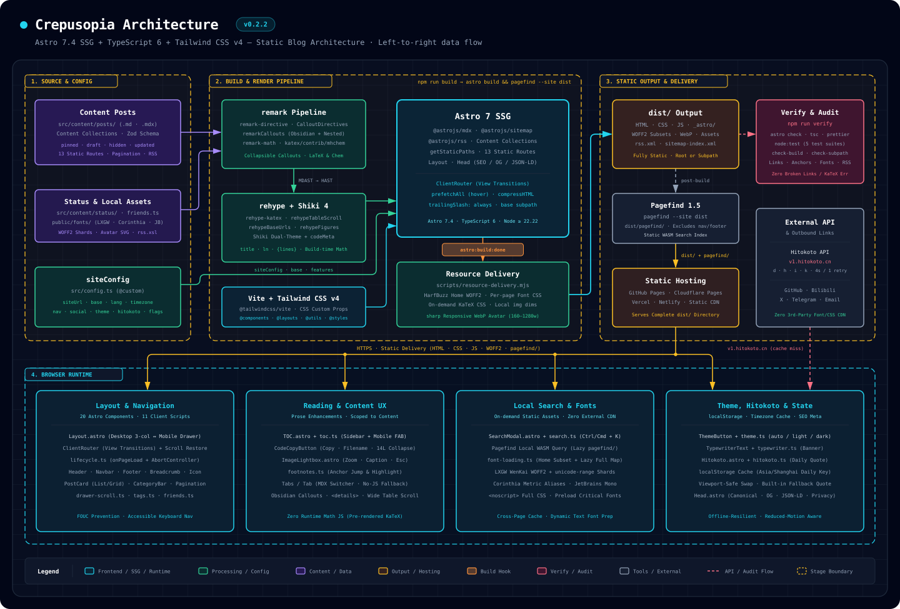

# Crepusopia

> **Crepusopia** = _Crepusculum_（拉丁语「黄昏」）+ _Utopia_（乌托邦）—— 暮光之中的理想国，在日夜交替之际记录思考与创作。

[](https://github.com/Swayopus/Crepusopia)
[](https://astro.build)
[](https://www.typescriptlang.org)
[](https://tailwindcss.com)
[](#lighthouse-实测表现)
[](./LICENSE)

一个基于 **Astro 7**、**TypeScript 6** 与 **Tailwind CSS 4** 从零打磨的个人静态博客。它以「默认零多余运行时开销」和「中文技术写作的细节体验」为出发点：纯静态构建、本地自托管字体分片、零第三方字体/样式 CDN 依赖、内置 Pagefind 离线全文搜索，并配有完整的自动化构建与产物回归验证。

---

## 核心特性

### 写作与内容表达

- **结构化内容集合**：基于 Astro Content Collections 与 Zod Schema 管理文章（`posts`，Markdown / MDX）与随记（`status`，Markdown），内建 `draft`、`hidden`、`pinned` 与 `updated >= published` 元数据校验。
- **富正文增强**：支持 Obsidian 风格及容器指令 Callout（可折叠、可嵌套）、构建期预渲染 KaTeX 数学公式与 `mhchem` 化学式、脚注跳转回跳高亮、原生 `<details>` 折叠区与窄屏局部横向滚动表格。
- **代码阅读体验**：Shiki 4 双主题语法高亮（暗色注释对比度专项优化），围栏元数据支持 `title`/`filename` 文件名、`ln` 行号与 `{2,4-5}` 重点行标注；内置一键复制（不含行号）与 14 行自动折叠。
- **图文与交互组件**：独占段落图片自动封装为 `<figure>` 图注并支持灯箱缩放（`Esc` 或点击遮罩关闭）；MDX 文章支持 `<Tabs>` / `<Tab>` 标签页，无 JavaScript 时优雅降级为顺序展开。

### 浏览与站内体验

- **自适应双形态布局**：宽屏鼠标设备呈现桌面侧栏（文章页为三栏，含跟随式目录），移动端与触屏设备切换为固定顶栏 + 滑出抽屉与浮动目录面板。
- **丝滑换页与本地搜索**：集成 Astro `ClientRouter`（View Transitions）与悬停/聚焦预取；`Ctrl/Cmd + K` 唤起 Pagefind 本地 WASM 全文搜索，索引随构建生成、按需加载。
- **主题与个性细节**：浅色 / 深色 / 跟随系统三态切换并做首屏防闪烁处理（FOUC Guard）；提供随记时间线、年份归档、分类/标签筛选、阅读时间估算、上下篇导航、友链页、打字机横幅与按站点时区缓存的每日一言。
- **完整 SEO 与订阅**：内置 RSS（附带 XSL 美化样式）、Sitemap、Canonical、Open Graph、Twitter Cards、JSON-LD 及隐私政策说明页。

### 性能与工程校验

- **零外部静态 CDN**：中文字体、品牌字体、代码字体与 KaTeX 样式/字体全部随站自托管，生产构建自动按页裁剪与分发，最大限度压低首屏体积与布局偏移。
- **发布前全链路验证**：`npm run verify` 一键串联 Prettier 格式检查、`astro check`、`tsc`、5 组 `node:test` 回归测试、生产构建与 `dist/` 全站坏链/锚点/字体/公式/索引审计；另支持一键子路径部署演练。

---

## Lighthouse 实测表现

在本地生产构建（`npm run build && npm run preview`）环境下，使用 **Lighthouse 13.5.0**（默认模拟网络与 CPU 节流）测得如下成绩：

| 测试页面                                       | 设备   | Performance | Accessibility | Best Practices |   SEO   |  FCP  |  LCP  |  TBT  | CLS | Speed Index | 总传输体积 |
| ---------------------------------------------- | ------ | :---------: | :-----------: | :------------: | :-----: | :---: | :---: | :---: | :-: | :---------: | :--------: |
| 首页 `/`                                       | 桌面端 |   **100**   |    **100**    |    **100**     | **100** | 0.3 s | 0.5 s | 0 ms  | `0` |    0.3 s    |  384 KiB   |
| 首页 `/`                                       | 移动端 |   **100**   |    **100**    |    **100**     | **100** | 1.1 s | 1.8 s | 0 ms  | `0` |    1.1 s    |  380 KiB   |
| 全特性长文 `/posts/content-features-showcase/` | 移动端 |   **98**    |    **100**    |    **100**     | **100** | 1.4 s | 2.3 s | 40 ms | `0` |    1.4 s    | 1,078 KiB  |

> 测试说明：移动端模拟 Slow 4G 网络与 4× CPU 降速；`/posts/content-features-showcase/` 为同时包含代码块、KaTeX 公式、化学式、嵌套 Callout、宽表格、脚注、SVG 图注与 MDX Tabs 的综合长文演示页。

全场景稳定保持 **`CLS = 0`** 与高分体验的关键工程手段包括：

1. **按页精准交付字体**：首页由构建钩子通过 HarfBuzz 动态生成仅包含首屏文本与基础 ASCII 的最小 WOFF2 子集，内页仅内联当前页所需分片并低优先级复用共享字库映射，同时以度量校准后的本地回退字体避免字体切换抖动。
2. **零公式运行时脚本 & 媒体预算控制**：KaTeX 数学与化学式全部在构建期渲染为静态 HTML+CSS，仅含公式的页面才加载样式；默认 SVG 头像自动生成多分辨率 WebP 缩略图，正文首图优先加载并自动补全本地图片宽高。
3. **无侵入动态更新**：每日一言先呈现当天有效缓存或内置兜底句，若异步拉取到新句子且区块仍在视口内，会延后至移出视口后再替换，杜绝阅读时正文跳动。

---

## 系统架构

[](docs/architecture.svg)

点击上方架构图可查看矢量原图；也可以打开自包含的 [HTML 版架构图](docs/architecture.html)，通过右上角 `⋯` 菜单直接复制或导出高分辨率 **PNG / PDF**。

整体数据流按从左到右分为四个阶段：

1. **1. SOURCE & CONFIG**：文章（`src/content/posts/`）、随记与本地静态资源（`src/content/status/`、`src/data/friends.ts`、`public/`）以及全局配置（`src/config.ts`）。
2. **2. BUILD & RENDER PIPELINE**：Markdown/MDX 经 `remark` → `rehype + Shiki 4` 处理后汇入 **Astro 7 SSG**（整合 `Vite + Tailwind CSS v4`）；构建完成后触发 `astro:build:done` 钩子运行 `scripts/resource-delivery.mjs` 完成字体、公式样式、图片尺寸与头像优化。
3. **3. STATIC OUTPUT & DELIVERY**：生成纯静态 `dist/` 产物，随后由 `Pagefind 1.5` 建立本地搜索索引并部署至任意静态托管平台；同时由 `npm run verify` 与 `check-build.mjs` 执行全量发布校验。
4. **4. BROWSER RUNTIME**：浏览器仅加载静态文件与按需模块，涵盖 20 个 Astro 组件、11 个客户端 TypeScript 模块（统一由 `lifecycle.ts` 管理换页清理），仅在无当天缓存时按需请求 `v1.hitokoto.cn`。

---

## 技术栈

| 层次     | 选型与实现                                                                                |
| -------- | ----------------------------------------------------------------------------------------- |
| 核心框架 | Astro 7.4（纯静态 SSG 输出 + `ClientRouter` 视图过渡）                                    |
| 语言     | TypeScript 6.0                                                                            |
| 样式     | Tailwind CSS 4.3（`@tailwindcss/vite`）+ CSS 自定义属性                                   |
| 内容管线 | Astro Content Collections、Markdown / MDX、`remark` / `rehype`、Shiki 4、KaTeX / `mhchem` |
| 全文搜索 | Pagefind 1.5（构建期生成静态 WASM 索引，浏览器本地检索）                                  |
| 字体媒体 | 本地 WOFF2 分片 + `unicode-range`、`subset-font`（HarfBuzz）、`sharp` 响应式 WebP         |
| 质量保障 | Prettier、`astro check`、`tsc`、`node:test`、`cheerio` 产物检查                           |
| 运行环境 | Node.js `>= 22.22.0` + npm                                                                |

---

## 快速开始

确保本地已安装 **Node.js 22.22.0 及以上版本** 与 npm：

```sh
git clone https://github.com/Swayopus/Crepusopia.git
cd Crepusopia
npm ci
npm run dev
```

开发服务器默认运行在 `http://localhost:4321/`（以终端输出为准）。在 Windows PowerShell 中如遇脚本策略限制，可使用 `npm.cmd` 替代 `npm`。

由于 Pagefind 搜索索引与资源交付优化在生产构建阶段执行，完整预览建议运行：

```sh
npm run build
npm run preview
```

提交或发布前，建议执行完整校验门禁：

```sh
npm run verify
```

### 常用命令

| 命令                     | 说明                                                               |
| ------------------------ | ------------------------------------------------------------------ |
| `npm run dev`            | 启动本地开发服务器                                                 |
| `npm run build`          | 执行 Astro 静态构建并生成 Pagefind 搜索索引                        |
| `npm run preview`        | 本地预览 `dist/` 生产产物                                          |
| `npm run check`          | 运行 `astro check` 与脚本 `tsc` 类型检查                           |
| `npm test`               | 运行 `tests/` 下的 5 组 `node:test` 回归测试                       |
| `npm run format`         | 使用 Prettier 按项目规范格式化代码                                 |
| `npm run format:check`   | 检查代码是否符合 Prettier 规范                                     |
| `npm run check:build`    | 审计 `dist/` 的站内链接、锚点、字体声明、公式、RSS 与搜索索引      |
| `npm run verify`         | 依次执行 `format:check`、`check`、`test`、`build` 与 `check:build` |
| `npm run check:subpath`  | 验证子路径（`base`）部署并自动恢复配置与重新构建                   |
| `npm run new-post`       | 通过 CLI 脚手架快速创建新文章                                      |
| `npm run fonts:generate` | 离线重新切分字体分片并完整校验（需 Python 字体依赖）               |
| `npm run fonts:check`    | 校验现有字体分片的字符覆盖、字形轮廓与度量（需 Python 字体依赖）   |

> 注意：`npm run check:subpath` 会临时改写部署前缀并重新构建，请勿与开发服务器或其他构建任务并发执行。

---

## 项目结构

```text
Crepusopia/
├── docs/                 # 架构图源码（architecture.html）与矢量图（architecture.svg）
├── public/               # 自托管字体、SVG 头像/图标、RSS XSL 样式与第三方许可文件
├── scripts/              # 构建包装、资源交付集成、产物审计、子路径验证、发文 CLI 与离线切字脚本
├── src/
│   ├── components/       # 20 个 Astro 页面与交互组件（TOC、SearchModal、Lightbox、Tabs 等）
│   ├── content/
│   │   ├── posts/        # Markdown / MDX 博客文章
│   │   └── status/       # Markdown 随记时间线
│   ├── data/             # 友链数据（friends.ts）
│   ├── layouts/          # 根布局骨架（Layout.astro）
│   ├── pages/            # 13 个静态路由（首页、文章、分页、归档、分类、标签、随记、友链、关于、隐私、RSS、404）
│   ├── scripts/          # 11 个模块化客户端脚本与生命周期管理器（lifecycle.ts）
│   ├── styles/           # 主题令牌（theme.css）、字体回退（font.css）、全局样式（global.css）
│   ├── utils/            # 内容查询、日期/阅读时间、URL 处理及 remark/rehype/Shiki 插件
│   ├── config.ts         # 站点全局配置入口
│   └── content.config.ts # Content Collections 加载器与 Zod Schema 校验
└── tests/                # 5 组 Node.js 回归测试（核心逻辑、资源交付、字体加载、标签导航、一言）
```

---

## 内容写作

### 创建文章

在 `src/content/posts/` 下新建 `.md` 或 `.mdx` 文件（支持嵌套子目录，路径即文章 URL），也可直接使用脚手架命令：

```sh
npm run new-post -- --title "新的记录" --slug "new-note" --tags "Astro,写作" --category "技术"
```

可选参数包括 `--desc "文章简介"` 与 `--pinned`；省略 `--slug` 时会自动根据标题生成文件名，且不会覆盖已有文件。

文章 Frontmatter 示例：

```yaml
---
title: "文章标题"
description: "用于文章卡片与 SEO 的简介"
published: 2026-10-20
updated: 2026-10-21
tags: [Astro, 写作]
category: 技术
author: Swayopus
pinned: false
draft: false
hidden: false
---
```

- 仅 `title` 与 `published` 为必填字段；`updated` 不得早于 `published`，`category` 为单个合法目录名。
- `image` 可选填封面路径（如 `/images/cover.webp`）；`author` 默认读取 `siteConfig.author`。
- `draft: true` 或 `hidden: true` 的文章不会生成详情页，也不会进入列表、归档、RSS 与 Pagefind 索引。

### 正文增强语法

以下增强仅作用于正文区域，完整效果可参考 [content-features-showcase.mdx](src/content/posts/content-features-showcase.mdx)：

- **Callout 提示块**：支持 Obsidian 语法（`> [!note]`、`> [!tip]+` 默认展开、`> [!question]-` 默认折叠，支持嵌套）以及容器指令（`:::warning ... :::`）。
- **公式与化学式**：行内 `$...$`、块级 `$$...$$`，化学式使用 `\ce{...}`。
- **代码块标注**：在代码围栏语言后追加元数据，如 ` ```ts title="src/app.ts" ln {2,4-5} `；达到 14 行的代码块默认折叠，复制时自动忽略行号。
- **图注与灯箱**：独占一段的图片自动生成 `<figure>` 并以 `alt` 作为图注，点击可放大预览；外层带链接的图片保持原样。
- **脚注与折叠区**：标准 Markdown 脚注在文末统一呈现为「注释」并支持跳转高亮；普通折叠区可直接使用 `<details><summary>...</summary></details>`（内部需渲染 Markdown 时改用 MDX）。
- **MDX 标签页 & 宽表格**：MDX 中引入 `Tabs` 与 `Tab` 即可创建多面板切换；普通 Markdown 宽表格在窄屏自动获得局部横向滚动容器。

### 发布随记

在 `src/content/status/` 下新建 `.md` 文件即可生成时间线条目（同样支持 `draft` 与 `hidden`）：

```md
---
date: 2026-10-20
link: https://example.com/
---

记录一段随想。
```

---

## 站点配置

绝大多数自定义项集中于 [src/config.ts](src/config.ts)：

| 配置项                                          | 用途说明                                                        |
| ----------------------------------------------- | --------------------------------------------------------------- |
| `siteUrl` / `base`                              | 正式站点地址（含末尾斜杠）与部署路径前缀                        |
| `title` / `subtitle` / `description` / `author` | 站点标题、副标题、SEO 简介与默认作者                            |
| `lang` / `timezone`                             | HTML `lang` 属性与日期/一言缓存所用的 IANA 时区                 |
| `theme.defaultMode`                             | 初始主题模式（`auto` / `light` / `dark`），用户手动选择优先     |
| `avatar` / `email` / `social` / `nav`           | 侧栏头像、公开邮箱、社交图标与导航顺序                          |
| `banner.subtitles`                              | 首页侧栏打字机文本列表                                          |
| `hitokoto.categories`                           | 每日一言分类过滤（默认 `d` 文学、`h` 影视、`i` 诗词、`k` 哲学） |
| `postList`                                      | 默认列表/网格视图、每页篇数、封面图与阅读时间开关               |
| `features`                                      | `katex`、`search`、`rss`、`sitemap` 功能总开关                  |

此外，首页自我介绍位于 `src/pages/index.astro`，关于页位于 `src/pages/about.astro`，友链清单位于 `src/data/friends.ts`，页脚运行时间起点可在 `src/components/Footer.astro` 修改；若更换站点头像，请同步更新标签页图标 `public/icons/favicon-avatar.svg`。

---

## 字体与资源交付机制

### 字体分工

| 场景                       | CSS 变量       | 字体                       |
| -------------------------- | -------------- | -------------------------- |
| 正文、导航、日期与普通标题 | `--font-body`  | LXGW WenKai GB Screen      |
| 站点名称                   | `--font-title` | Corinthia                  |
| 首页姓名                   | `--font-name`  | Corinthia Name（度量别名） |
| 行内代码与代码块           | `--font-mono`  | JetBrains Mono             |

霞鹜文楷（Regular 400）已按通用字频与 Unicode 区块预先切分为多份 WOFF2 分片，完整覆盖原字体全部字符与变体序列；**日常新增或修改文章只需正常执行 `npm run build`，无需运行 Python 字体工具**。仅在更换原始字体文件时，才需安装 `scripts/fonts/requirements.txt` 并执行 `npm run fonts:generate`（细节见 [scripts/fonts/NOTICE.md](scripts/fonts/NOTICE.md)）。

### 生产构建后处理（`scripts/resource-delivery.mjs`）

- **首页最小字体子集**：构建时提取首页实际文字、打字机字幕与基础 ASCII，通过 HarfBuzz 生成独立 `dist/_astro/lxgw-home-<hash>.woff2` 并预加载；完整字库映射地址仅存于 `<meta>`，当每日一言或搜索结果出现未覆盖字符时再由 `font-loading.ts` 按需激活对应分片。
- **内页按用字分发**：扫描各页正文所需分片内联关键 `@font-face`，同时以低优先级并行加载可跨页复用的共享完整映射，并提供 `<noscript>` 兜底。
- **按需样式与图片优化**：仅实际渲染出 `.katex` 的页面才注入独立 `math-*.css`；默认 SVG 头像自动派生 `160w`–`1280w` 响应式 WebP（保留原 SVG 供极高倍率缩放）；正文首图自动设为高优加载，其余图片保持懒加载，且自动写入本地图片真实宽高防止 CLS。
- **每日一言策略**：按站点时区以天为单位缓存至 `localStorage`；无当天有效缓存时先显示内置兜底句，再向 `v1.hitokoto.cn` 发起 4 秒限时请求（失败间隔 1 秒重试一次，换页立即取消）。排查状态可检查 `.hitokoto-block` 上的 `data-hitokoto-state`、`data-hitokoto-attempts` 与 `data-hitokoto-error` 属性。

---

## 部署

构建输出为纯静态目录 `dist/`，可直接托管至 **GitHub Pages**、**Cloudflare Pages**、**Vercel**、**Netlify** 或任意对象存储/静态服务器：

- **安装命令**：`npm ci`
- **构建命令**：`npm run build`
- **输出目录**：`dist`（需完整发布，包含 `_astro/`、`pagefind/`、字体、RSS 与 Sitemap）

部署到子路径（如 GitHub Pages 项目页）时，在 `src/config.ts` 中同步设置 `siteUrl` 与 `base` 即可：

```ts
siteUrl: "https://username.github.io/",
base: "/Crepusopia/",
```

构建管线会自动为 Markdown、MDX 及原生 `<a>`/`` 中的站内绝对路径补齐 `base` 前缀（动态表达式或自定义组件参数可使用 `src/utils/url.ts` 中的 `withBase()`）。若部署至 GitHub Pages，建议使用官方静态工作流以禁用 Jekyll 对 `_astro/` 等下划线目录的过滤。

---

## 开发约定

- 代码风格统一采用 Prettier + `prettier-plugin-astro`（UTF-8、LF、2 空格缩进），文章正文与静态资源不纳入自动改写。
- 所有绑定 DOM 事件、计时器或观察器的客户端模块均通过 `src/scripts/lifecycle.ts` 的 `onPageLoad(signal)` 注册，确保 `ClientRouter` 换页时不出现重复初始化或内存泄漏。

---

## 致谢与许可证

- **字体**：[LXGW WenKai GB Screen](https://github.com/lxgw/LxgwWenKai)（SIL OFL 1.1）、[Corinthia](https://fonts.google.com/specimen/Corinthia)（SIL OFL 1.1）与 [JetBrains Mono](https://www.jetbrains.com/lp/mono/)（SIL OFL 1.1），许可原文分别附于 [LXGW WenKai](public/fonts/LXGWWenKai/OFL.txt)、[Corinthia](public/fonts/Corinthia/OFL.txt) 与 [JetBrains Mono](public/fonts/JetBrainsMono/OFL.txt)。
- **公式**：[KaTeX](https://katex.org/)（[MIT 许可](public/licenses/KaTeX-MIT.txt)）及其内置字体（[SIL OFL 1.1 许可](public/licenses/KaTeX-fonts-OFL.txt)）。
- **设计参考与架构图**：感谢 [Fuwari](https://github.com/saicaca/fuwari)、[Firefly](https://github.com/CuteLeaf/Firefly)、[Neomelt Blog](https://github.com/Neomelt/Neomelt_blog)、[Retypeset](https://github.com/radishzzz/astro-theme-retypeset)、[AstroPaper](https://github.com/satnaing/astro-paper) 等开源博客项目的启发，以及 [Cocoon AI Architecture Diagram Skill](https://github.com/Cocoon-AI/architecture-diagram-generator) 提供的架构图设计规范。
- **项目源码**：采用 [MIT License](LICENSE) 开源。
